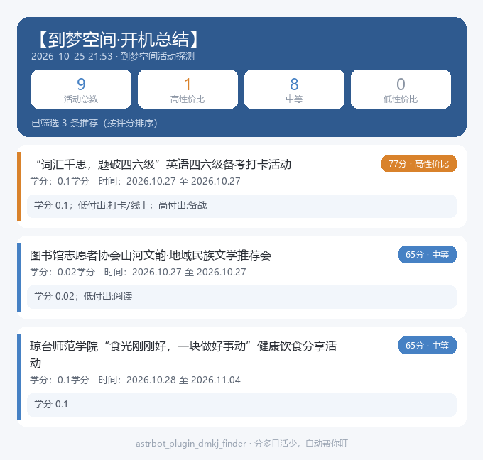

# astrbot_plugin_dmkj_finder

到梦空间（DMKJ）活动探测器 + AI 筛选推送插件。自动轮询学校到梦空间的新活动，
用「AI 评分 / 规则打分」找出**学分高、付出低**的活动（看电影、讲座、签到、打卡类），
合并成一条消息推送到你的微信 / 群。



> 适用场景：想躺平拿学分，让机器人帮你盯着「分多且活少」的活动自动提醒。

---

## 特性

- **完整分页扫描**：从第一页逐页获取直到空页，不再只处理前 40 条；跨页按活动 ID 去重。后续页失败时取消本轮，保留上一次缓存，避免把没拉到的活动误判为下架。每页请求前检查报名保护期。

- **省 token 设计**：每分钟只拉活动列表（轻量）；**只有出现新增活动**才进入评分，
  稳定态（无新增）几乎 0 token。
- **一次批量评分**：把所有新增活动打包成**一条** prompt 交给模型，只回 JSON，不拉大段正文。
- **优先用 AstrBot 已配置的模型**：无需在插件里再填 API Key；可在配置页下拉选择用哪个模型。
- **规则兜底（免费）**：未启用 AI 或模型调用失败时，自动降级为本地规则打分，不影响推送。
- **持久去重**：已推送 / 已判断过的活动不会再重复打扰。
- **开机上线通知**：插件启动后先推一条「🟢 已上线」——含插件版本、登录的账号（姓名/学校/脱敏手机）、
  活动总量与剩余待处理量；登录失败也会通知并附原因，方便第一时间发现配置问题。
- **长图卡片推送**：推荐较多（默认 ≥6 条）时自动把「总结 + 推荐列表」渲染成一张白底钢蓝卡片长图，
  告别文字墙；推荐少时仍用文本。渲染失败自动回退文本，不会推不出来。
- **开机总结 + 推荐**：插件启动约 5 秒后，自动**先总结当前全部活动**（总数 + 高/中/低性价比分布），
  **再推送推荐的（高性价比）活动**；之后正常轮询只推**真正新增且高性价比**的活动。
  可用 `/dmkj scan`（别名 `/dmkj pushall`）手动触发，也可在配置里关掉（`startup_push=false`）。
- **个人微信 / 群推送**：复制会话标识即可接收，支持个人微信与 QQ。

---

## 安装

方式一（推荐）：解压后把整个 `astrbot_plugin_dmkj_finder/` 目录放进 AstrBot 的
`data/plugins/`，在 WebUI「插件管理」启用。

方式二：直接在 WebUI「插件管理 → 上传插件」里上传 `astrbot_plugin_dmkj_finder.zip`。

> 要求 AstrBot >= 4.5.7（用了 `llm_generate` 新接口；`select_provider` 需 >= 4.0.0）。
> 实测环境：AstrBot v4.29.3。

---

## 配置（`_conf_schema.json`）

| 配置项 | 类型 | 说明 |
| --- | --- | --- |
| `account.phone` | string | 到梦空间登录手机号 |
| `account.password` | string | 到梦空间登录密码（UI 中脱敏显示） |
| `poll_interval` | int | 轮询间隔（秒），默认 `60` |
| `timeout` | int | 到梦空间接口请求超时（秒），默认 `12`；网络慢可适当调大 |
| `push_threshold` | int | 评分 >= 此值才推送。该校学分多为 0.01~0.1，建议 `20~40`，默认 `30` |
| `startup_push` | bool | 开机自动扫描：总结全部活动并推送推荐的（高性价比）活动，默认 `true` |
| `startup_notice` | bool | 开机推送上线通知（状态/登录账号/剩余待处理量），默认 `true` |
| `llm.enabled` | bool | 是否启用 AI 评分（false = 纯规则兜底，0 token） |
| `llm.provider` | string（`_special: select_provider`） | 下拉选择用于评分的 AstrBot 模型；**留空 = 用 AstrBot 默认模型** |
| `llm.batch_size` | int | 每次 LLM 调用打包的活动条数，默认 `12`；模型响应慢/超时可调小（如 `6`） |
| `push.session` | string | 推送目标会话标识 `unified_msg_origin`（见下方获取方式，**必须配置，否则不推送**） |
| `push.as_image` | bool | 推荐较多时用长图卡片推送（默认 `true`；依赖 AstrBot 文转图服务，失败自动回退文本） |
| `push.image_min` | int | 推荐条数 ≥ 此值才用长图，否则用文本（默认 `6`） |
| `push.platform_id` / `push.target_id` / `push.is_group` | string/bool | 备选：仅 QQ（aiocqhttp）可用，填 QQ 号 / 群号 |

### 设置推送目标（必需，否则完全不推送）

> ⚠️ **不配置 `push.session`（或 `push.target_id`）插件不会推送任何消息**——开机扫描会正常运行（日志里有警告），但消息无处可发。

机器人需要知道往哪发。最稳妥的方式：

1. 在**你想接收推送的群 / 私聊**里给机器人发：`/dmkj session`
2. 机器人会回一行 `unified_msg_origin` 字符串，复制它
3. 粘贴到插件配置的 `push.session` 里保存并重启插件 / 重载

（QQ 用户也可不填 `session`，改用 `push.target_id` + `push.platform_id` + `push.is_group`。）

验证是否配好：发 `/dmkj status`，看「推送目标」一行是否显示那个会话串；再发 `/dmkj scan` 立即触发一次「总结+推荐」推送，确认能收到。

### 启用 AI 评分

1. 确认 AstrBot 已配置好至少一个模型（`模型提供商 → 对话`）。
2. 插件配置里把 `llm.enabled` 设为 `true`。
3. `llm.provider` 下拉里选一个模型（或留空用默认模型）。

未启用 / 模型不可用时会自动退回规则打分，不会报错中断。

---

## 指令

### 可参与优先与报名保护

`/dmkj list` 用合并转发回复当前会话，展示通过报名资格筛选且已有评分的全部活动（含低分和未推荐活动），不调用到梦接口或模型，报名保护期内也可使用。需先加入部落的活动保留并标注条件；院系不符、已报名、满员和资格未知条目不列入。模型关闭或失败时标注规则评分来源。其他推送仍按报名资格分组。等待开放按开放时间、可报名按截止时间、已报名按活动开始时间排序，其余保留接口顺序。文字和长图均展示服务端原因，长图中满员及受限条目置灰。

推荐仅包含可报名、等待开放及可通过加入部落解锁的活动；完整列表仍保留全部活动。院系不符条目在模型调用前排除，使用本地规则评分。别院部落标为永久不可参与；只有确认本院或非学院部落时才提示加入，院系未知时不猜测。部落 ID 可用时一并显示，需在官方客户端手动搜索加入。

报名提醒只针对已确认有资格且尚未报名的活动。**触发报名提醒时立即暂停所有到梦空间轮询及自动重登 30 分钟**，`now`、`scan` 同样暂停，`list` 仅查看缓存仍可使用；保护期落盘，重启保留，到期自动恢复。失败重发同一提醒不会延长保护期，新活动提醒会重新延长至触发后 30 分钟。缓存提醒不受影响。触发前已发出的请求无法撤回；保护期间不启动新请求。

`/dmkj status` 显示保护期和恢复时间。`eligibility.notify_changes` 默认开启，受限/满员/等待开放变为可报名或等待开放时通知；`eligibility.cache_ttl` 默认600秒，活跃状态按轮询间隔刷新（至少60秒），最多4个详情并发。保护期内全部详情刷新也会暂停。登录失效仅在保护期外自动重登一次。当前院系优先取登录响应，可用 `eligibility.college_id` 补充；未知资格不会触发报名提醒。

### 报名开始前提醒

在插件配置中设置：

```json
{
  "signup_reminder": {
    "enabled": true,
    "minutes_before": 10,
    "priorities": ["高性价比", "中", "低性价比"]
  }
}
```

默认开启，提前 **10 分钟**，默认只提醒「高性价比」。`priorities` 可多选「高性价比」「中」「低性价比」，空列表表示不提醒任何等级。沿用现有评分：高 ≥70、中 40～69、低 <40，同批按评分降序发送。提醒独立于 `push_threshold`，复用现有推送目标。

每 15 秒检查缓存；在提醒窗口内才发现的活动也会补提醒，报名已经开始则跳过。网络、评分或发送耗时可能造成延迟。使用实测接口 `joinstartdate`（兼容 `joinStartDate` / `joinStartTime` / `joinstarttime` / `joinStart`）字段，支持秒/毫秒时间戳、完整日期时间；无时区时按北京时间解释，缺失或无法解析则跳过，不使用活动举行时间代替。

状态保存在插件数据目录 `signup_reminders.json`，成功发送后去重，重启保留，报名时间变更后可再次提醒。开启时会刷新尚未开始报名的已见活动详情，复用已有评分；升级前已见且没有评分缓存的活动使用规则评分，新活动及手动全量扫描中通过资格筛选的条目仍按原 AI/规则配置评分。

`enabled=false` 关闭，`minutes_before` 最小 1、非法值回退到 10；保存配置后重载插件。

| 指令 | 作用 |
| --- | --- |
| `/dmkj list` | 合并转发当前缓存中所有通过资格筛选的评分活动，不受推荐阈值限制，回复当前会话 |
| `/dmkj now` | 立即轮询一次（增量模式，仅处理新增），便于调试 |
| `/dmkj scan`（别名 `/dmkj pushall`） | 立即做一次全量扫描：总结所有活动并推送推荐的（忽略去重） |
| `/dmkj status` | 查看运行状态：模式、上次评分方式、已记录活动数、上次轮询时间、开机总结是否完成、最后错误 |
| `/dmkj image` | 测试长图链路：渲染一张样例长图直接发到**当前会话**（不占用 push.session），并回复渲染方式（t2i / 本地 Pillow） |
| `/dmkj session` | 打印当前会话标识 `unified_msg_origin`，复制到 `push.session` 即可收推送 |

---

## 评分逻辑

该校活动学分普遍很小（多为 0.01~0.1 学分），因此「**付出高低**」是主要判断依据，学分仅作微调。规则打分（0~100）：

- 基线 50（中性 ≈ 中等）。
- 低付出词（观影 / 讲座 / 培训 / 签到 / 打卡 / 晨读 / 心理团辅 / 解压 / 阅读 / 答题 / 体验 …）→ 每条 +12（上限 +30）。
- 高付出词（心得 / 征文 / 论文 / 报告 / 截图 / 转发 / 排练 / 训练 / 比赛 / 创作 / 手工 …）→ 每条 −12（上限 −30）。
- 学分微调：`min(20, 学分×150)`（0.1 学分≈+15，0.01 学分≈+1.5）。
- 评级：`>=70` ⭐高性价比·低付出，`>=40` ✅中等，否则 ⚠️低性价比。
- 分值 `>= push_threshold`（默认 60）的活动才会被「推荐」推送。

启用 AI 时，由 AstrBot 模型在语义上做更细的判断，返回 `push / score / label / reason`；模型不可用时自动退回上述规则打分。

> 想让推荐更「精」就调高 `push_threshold`（如 70 只推最省心的）；想多推就调低（如 50）。

---

## 数据流

```
插件启动(~5s)                                   每 poll_interval 秒
  ├─ 开机总结+推荐（startup_push=true 时）       → 登录并拉活动列表（仅列表字段）
  │   → 拉当前全部活动（不去重）                  → SeenStore 过滤出「新增」活动
  │   → analyzer 评分（AI / 规则）                → 仅对新增活动：拉详情前 120 字说明
  │   → 总结：总数 + 高/中/低性价比分布           → analyzer 评分（AI 批量一次 / 规则兜底）
  │   → 推送「推荐」（高性价比）活动明细           → 把 push=true 的活动合并成一条消息
  │   → 全部标记已见                              → 推送到 push.session
  └─（若 startup_push=false 则跳过）             → 标记已见（去重）
```

---

## 控制台日志（登录状态 / 轮询结果）

插件在 AstrBot 控制台 / 日志里会打印带 `[dmkj_finder]` 前缀的状态行，方便你确认登录与轮询情况：

| 日志 | 含义 |
| --- | --- |
| `✅ 登录成功：姓名（学校）uid=...` | 登录到梦空间成功（仅在真正登录/重新登录时打印） |
| `📋 轮询结果：到梦空间列表共 N 条，{新增/全量}待处理 M 条` | 每次轮询拉到多少活动、其中多少待评分 |
| `📤 已处理 X 条，推送推荐 Y 条（评分方式：...）` | 本轮评分并推送了几条 |
| `📨 消息已推送至会话：...` | 消息已送达目标会话 |
| `⚠️ 未配置推送目标 ...` | **没配 `push.session`，不会推送**（头号排查项） |
| `轮询异常: ...` / `开机扫描失败: ...` | 网络/登录/接口异常（会自动清缓存下次重登） |

---

## 常见问题

- **装上后报错 `原因：'type'`**：旧版 `_conf_schema.json` 用了裸默认值。请使用本仓库带
  `type` 字段的 schema（已修复）。
- **开机/定时完全没推送（什么消息都没收到）**：
  1. **先确认 `push.session` 配了没有**——这是头号原因。发 `/dmkj status` 看「推送目标」是否显示会话串；
     若显示「（未配置！…）」就是没配。到目标群/私聊发 `/dmkj session` 复制串，填进 `push.session` 重启插件。
  2. 配好后发 `/dmkj scan` 立即触发一次「总结+推荐」推送，能收到说明链路通了；之后每次开机约 3~5s 会自动推一次。
  3. 若还是没收到：看 AstrBot 日志里有没有 `[dmkj_finder]` 的报错/警告（如登录失败、网络超时、模型调用失败）。
  4. 调度器已显式绑定到 AstrBot 运行事件循环（参考官方 `reminder` 插件的做法），开机任务用 `asyncio.create_task`
     派发，不受 APScheduler misfire 影响；若你改过 `poll_interval` 很大，首条增量推送会相应延后。
- **一直没推送 / 推荐太少**：先确认 `account` 填对、`push.session` 填对（用 `/dmkj session` 复制）；
  再用 `/dmkj now` 看「上次新增」与「最后错误」。规则打分基线为 50、低付出 +12、高付出 −12，
  推荐阈值为 60（已按该校学分重校准，值域 0~100）。若想多推，把 `push_threshold` 调低（如 50）；
  若想只推最省心的，调高（如 70）。
- **开机推太多**：开机总结会把评分 ≥ `push_threshold` 的活动都作为「推荐」推送。把 `push_threshold`
  调高即可收窄（如 70 只推 ⭐高性价比）。
- **想用指定模型评分**：`llm.enabled=true` 后在 `llm.provider` 下拉选择。
- **模型调用失败**：插件会自动退回规则兜底，日志会提示降级原因。
- **长图没发出来、还是收到文字**：长图依赖 AstrBot 的文转图（t2i）能力。渲染或发送失败时插件会打
  `长图渲染失败，回退文本推送` 并自动改发文本——先确认 AstrBot 的 t2i 服务可用（可在 WebUI 里试
  AstrBot 自带的文转图指令）。只是想关掉长图：`push.as_image=false`；想降低长图触发门槛：调小
  `push.image_min`。
- **控制台出现 `[OpenAI] Request failed with retryable error; retrying (N/5): Request timed out`**：
  这是 AstrBot 核心对**你配置的对话模型**发起请求超时后的重试提示（非插件崩溃）。开启 AI 评分后，
  插件已按 `llm.batch_size`（默认 12 条/次）分批小请求来降低单次响应时长；若仍超时：
  1. 把 `llm.batch_size` 调小（如 `6`）；
  2. 换一个响应更快的模型做评分（推理型/本地大模型生成 JSON 会很慢）；
  3. 或直接 `llm.enabled=false` 用规则兜底（0 token，推送不受影响——LLM 最终失败会自动降级规则）。
- **控制台出现 `skipped: maximum number of running instances reached`**：这是 APScheduler 发现上一轮轮询还没跑完、本轮又到点的提示。已通过「轮询互斥守卫 + `max_instances`/`misfire_grace_time`/`coalesce`」修复——同一时刻只会跑一次拉取，叠乘的轮询会立即跳过而不再刷该告警。若仍偶发，多半是单次拉取太慢（活动多/网络慢），可把 `timeout` 调大或 `poll_interval` 调大。
- **微信推送报 `weixin_oc ... ret=-2, errmsg=prepare failed`**：这是微信 iLink 个人号通道的**突发频控惩罚**（约 5~6 条/窗口；惩罚期内继续发送会**延长**惩罚）或会话未激活。已内置防护：同一轮推送的多条消息间隔 `push.send_gap`（默认 3s），发送失败后退避 `push.send_backoff`（默认 15s）再重试，连续失败 2 次自动止损（避免热重试延长惩罚）。**恢复方法：给机器人发一条任意消息**（入站消息会立即激活会话），然后等下一轮轮询或发 `/dmkj now`。
- **推送/频控相关可调参数**：`push.send_gap`（消息间隔）、`push.send_backoff`（失败退避秒数）。若你的通道是 QQ（aiocqhttp）等无频控平台，保持默认即可。

---

## 目录结构

```
astrbot_plugin_dmkj_finder/
├── main.py            # 插件主体：定时轮询 / 推送 / 指令
├── analyzer.py        # 评分（AI 批量 + 规则兜底）
├── dmkj_client.py     # 到梦空间 v6 客户端（登录 / 列表 / 详情）
├── seen_store.py      # 持久化去重
├── _conf_schema.json  # 配置项定义
├── metadata.yaml
├── requirements.txt   # requests, pycryptodome
└── README.md
```
